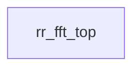
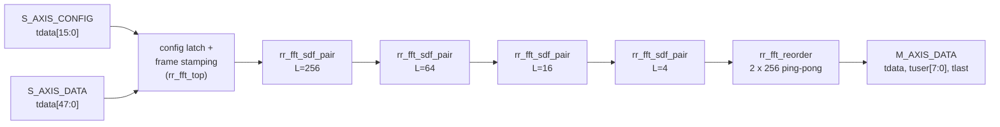

<!-- rr:fdd v1 ip=rr_fft_top -->
# rr_fft_top — Firmware Design Document

<!-- rr:fdd:generated:begin -->
<!-- rr:fdd:inputs sha256:28b022a9f803a9ca -->
<!-- rr:fdd:projection v3 -->
> Machine-owned block — scaffolded by `rr fdd init`, refreshed by
> `rr fdd generate`. Do not edit inside the markers;
> edit the canonical declarative files it references. FDD state is
> documentation completeness only — never behavioral proof.

**IP:** `rr_fft_top` v0.1

## Canonical References

- **Requirements** — `requirements.yml`: FFT-REQ-001 (behavioral), FFT-REQ-002 (behavioral), FFT-REQ-003 (behavioral), FFT-REQ-004 (behavioral), FFT-REQ-005 (behavioral), FFT-REQ-006 (behavioral), FFT-REQ-007 (behavioral), FFT-REQ-008 (behavioral), … (+9 more — see the Requirements table below)
- **Interfaces** — `requirements.yml` port_contract:
  - `S_AXIS_CONFIG` — axi-stream slave
  - `S_AXIS_DATA` — axi-stream slave
  - `M_AXIS_DATA` — axi-stream master
  - clocks: `ACLK`
  - resets: `ARESETN`
  - 1 scalar port(s)
  - parameters: `LOG2_N`=8, `DATA_WIDTH`=24, `TWIDDLE_WIDTH`=24, `NATURAL_ORDER`=True
  - _contract_: declared here from the contract — not proof the HDL matches; verify with `rr sim contract-check`
- **Registers** — none declared
- **Dependencies** — `ip.yml` build.ips: none declared
- **Decisions** — no `decisions.yml`

## Requirements

| ID | Kind | Requirement |
|---|---|---|
| FFT-REQ-001 | behavioral | Forward transform of any input frame is bit-exact to the model/ oracle for every legal scale schedule (truncation rounding at every stage boundary). |
| FFT-REQ-002 | behavioral | Inverse transform in unscaled mode is bit-exact to the oracle, including full bit growth (DATA_WIDTH + LOG2_N + 1 output). |
| FFT-REQ-003 | behavioral | With NATURAL_ORDER, output samples are emitted in natural index order and xk_index (`M_AXIS_DATA_TUSER`) matches the sample index for every sample of every frame; `M_AXIS_DATA_TLAST` marks the final sample. |
| FFT-REQ-004 | behavioral | A config word (FWD_INV + scale schedule) accepted on `S_AXIS_CONFIG_TDATA` applies to the NEXT frame boundary and never mid-frame. |
| FFT-REQ-005 | behavioral | Back-to-back frames with zero idle cycles are processed at II = 1 with no sample loss or corruption (realtime throttle contract: the core never backpressures the producer). |
| FFT-REQ-006 | behavioral | Deasserting `ACLKEN` freezes all architectural state exactly; resuming produces the identical output stream as an ungated run. |
| FFT-REQ-007 | behavioral | FFT of an IFFT (and vice versa) reproduces the input frame exactly, within the deterministic scaling predicted by the oracle for the chosen schedules (round-trip identity). |
| FFT-REQ-008 | behavioral | The datapath advances on accepted input beats only (data-pushed): with `S_AXIS_DATA_TVALID` idle, `M_AXIS_DATA_TVALID` never rises, regardless of in-flight samples; those samples are emitted only as subsequent input beats (flush) push them through the pipeline. |
| FFT-REQ-020 | behavioral | Scaled shim: the xfft v9.1 port shape (16-bit config, 48-bit data, tlast in, event outputs) is a transparent adapter — output stream bit-exact to the bare core for the same stimulus. |
| FFT-REQ-021 | behavioral | Unscaled shim: 8-bit config carries FWD_INV only; each 33-bit output component is sign-extended to 40 bits (80-bit tdata, xfft byte-padding convention), values bit-exact to the oracle. |
| FFT-REQ-022 | behavioral | Scaled shim, config word 0x156 (FWD_INV = 0, inverse; schedule [3, 2, 2, 2] from the input-side pair): back-to-back frames are bit-exact to the oracle, xk_index equals the natural-order bin and `M_AXIS_DATA_TLAST` marks bin N-1 of every frame. |
| FFT-REQ-023 | behavioral | Unscaled shim, config word 0xB1 (FWD_INV = 1, forward; bits 7:1 have no effect): back-to-back frames are bit-exact to the oracle with each 33-bit component sign-extended to 40 bits, xk_index equals the natural-order bin and `M_AXIS_DATA_TLAST` marks bin N-1 of every frame. |
| FFT-REQ-024 | behavioral | xfft equivalence, config 0x156: over the FFT-REQ-022 corpus the output differs from the xfft v9.1 C model by at most 1 LSB per component, and the SNR against it is at least 100 dB on every full-scale frame. |
| FFT-REQ-025 | behavioral | xfft equivalence, config 0xB1: over the FFT-REQ-023 corpus the output differs from the xfft v9.1 C model by at most 64 LSB of the 33-bit output, and the SNR against it is at least 120 dB on every full-scale frame. |
| FFT-REQ-030 | behavioral | DC response: for a constant input frame the first output sample X[0] is bit-exact to the oracle under every legal scale schedule, in both scaled and unscaled modes. Exercises the adder tree, the truncating scale schedule and the output packing; the twiddle multipliers are deliberately not covered (a DC frame bypasses W^0), so this REQ complements rather than replaces FFT-REQ-001. |
| FFT-REQ-040 | behavioral | The top generic G_TWIDDLE_ROM_STYLE ("distributed", the default, or "block"; any other value fails elaboration) selects where the first stage pair's twiddle ROM is held: in LUTs, or in one block RAM (a registered read). The style changes resources only: with "block" the `M_AXIS_DATA_TDATA` stream is bit-exact to the oracle in both directions and the latency from `S_AXIS_DATA_TVALID` to `M_AXIS_DATA_TVALID` equals the default build's (557 cycles over three back-to-back frames). The twiddle_block target carries the block-RAM resource budget below. |
| FFT-REQ-101 | negative | No `M_AXIS_DATA_TVALID` beat is ever emitted with stale or X-init frame content after `ARESETN` deassertion (first output frame is fully computed from post-reset input only). |

## Register Map

none declared

## Block Diagram

## Decision Index

none declared
<!-- rr:fdd:generated:end -->

Facts verified on 2026-10-21 against the RTL of this revision. Model checks with routertl 5.0.0; simulation, lint and routed timing with routertl 5.1.0 (dev). Twiddle ROM style (`G_TWIDDLE_ROM_STYLE`, FFT-P2.12), synthesis and routed timing of all three build targets verified on 2026-11-07 with routertl 5.3.0 (dev) and Vivado 2024.1. RouteRTL VHDL style (FFT-P2.13): lint, simulation, cycle equivalence and routed timing of all three build targets verified on 2026-11-08 with routertl 5.3.0 (dev), nvc and Vivado 2024.1.

## Overview

- `rr_fft_top` is a pipelined streaming FFT/IFFT core in VHDL-2008, package `routertl/fft` v0.3.1 (`ip.yml`).
- Transform length 256 points, 24-bit complex input, 24-bit twiddles (`rtl/rr_fft_pkg.vhd`: `C_LOG2N` = 8, `C_DW` = 24, `C_TW` = 24).
- Direction (forward or inverse) is selected per frame through an AXI-Stream configuration channel.
- Two build variants, selected by the generic `G_HAS_SCALING`:

| `G_HAS_SCALING` | Scaling | Output width per component | Overflow behaviour |
|---|---|---|---|
| `true` (default) | runtime schedule, 0 to 3 bit shift per stage pair | 24 bits | two's-complement wrap |
| `false` | none, full bit growth | 33 bits | none (widths sized by the width plan) |

- Storage of the first stage pair's twiddle ROM, selected by the generic `G_TWIDDLE_ROM_STYLE` (FFT-REQ-040). Output stream and latency are the same for both values; any other value fails elaboration:

| `G_TWIDDLE_ROM_STYLE` | First pair's twiddle ROM | Block RAM tiles | Logic LUT, routed, scaled |
|---|---|---|---|
| `"distributed"` (default) | LUTs | 1 | 1180 |
| `"block"` | 2 RAMB18 | 2 | 1008 |

- The arithmetic reference is the fixed-point oracle `model/rr_fft_oracle.py`. The RTL output is bit-exact to it (FFT-REQ-001, FFT-REQ-002).
- `rr_fft_xfft_shim` adapts the core to the port shape of the Xilinx xfft v9.1 instances it is built to replace (FFT-REQ-020, FFT-REQ-021).
- No vendor primitive is instantiated. All memories are inferred.

## Theory of Operation

- Algorithm: radix-2² decimation-in-frequency, single-path delay feedback (SDF), one sample per clock.
- Four stage pairs process block sizes L = 256, 64, 16, 4. Each pair is one radix-2² step (two radix-2 butterflies, one trivial ±j rotation, one twiddle multiply).
- The pipeline emits bins in bit-reversed order. A ping-pong reorder buffer converts to natural order.
- Data-pushed operation (FFT-REQ-008): the butterfly delay lines shift only on accepted input beats. With `S_AXIS_DATA_TVALID` low, no output is produced. The last frame of a stream is emitted only when later input beats (for example zero samples) push it through.
- Throughput: one complex sample per `ACLK` cycle with `ACLKEN` = 1, gapless frames back to back (FFT-REQ-005). `S_AXIS_DATA_TREADY` and `S_AXIS_CONFIG_TREADY` are tied to 1. The output channel has no `tready`.
- Configuration is a per-beat sideband. The top latches the active configuration at the first beat of each frame and the configuration travels with each sample through all four pairs. No global frame counter or control fanout exists.
- Inside a pair the butterfly feedback lines carry data only. The configuration is constant over a frame and every block of L beats lies inside one frame, so a sample drained from a line carries the configuration of the previous block (BF2I fill half, BF2II quarter q0) or of the current block (BF2II quarter q2). Each butterfly holds the configuration of the previous block in one register (`pcfg1`, `pcfg2`).
- `ACLKEN` = 0 holds every register (FFT-REQ-006). Reset is not gated by `ACLKEN`.
- Recorded latency, LatencyProbe worst case `S_AXIS_DATA_TVALID` to `M_AXIS_DATA_TVALID`, gapless frames: 557 `ACLK` cycles in both builds, in both twiddle ROM styles (`test_fft_twiddle_block.py`, `test_fft_shim_twiddle_block.py`, FFT-REQ-040) and in every test file, including the reference-deployment configurations 0x156 and 0xB1 (2304 paired beats each, `sim/results/test_fft_shim_live_*/latest.json`, run of 2026-10-21). The contract ceiling is 640 cycles (`requirements.yml` technical tier).
- The latency differs from the xfft v9.1 instances it replaces. Measured in xsim on the generated IP (Vivado 2024.2), first accepted input beat of a frame to its first output beat, `ACLKEN` = 1:

| Configuration | xfft v9.1 | rr_fft | Difference |
|---|---|---|---|
| scaled, config 0x156 | 615 cycles (616 for the first frame after reset) | 557 cycles | 58 cycles |
| unscaled, config 0xB1 | 611 cycles (612 for the first frame after reset) | 557 cycles | 54 cycles |

- After reset the xfft holds `S_AXIS_DATA_TREADY` low for one cycle after the first accepted beat, which accounts for the extra cycle of the first frame. `rr_fft` holds `S_AXIS_DATA_TREADY` at 1 on every cycle.

## Architecture

### Block diagram

- Clock `ACLK`, reset `ARESETN` and clock enable `ACLKEN` go to every block.
- Each arrow between pairs carries real part, imaginary part, valid and the 9-bit configuration sideband.

### Source files

| File | Entity / package | Function |
|---|---|---|
| `rtl/rr_fft_pkg.vhd` | `rr_fft_pkg` | constants, twiddle ROM generator `f_twiddle_rom`, bit reversal `f_bitrev`, width plan `f_wplan`, shim widths `f_shim_cfg_w` / `f_shim_ow` |
| `rtl/rr_fft_top.vhd` | `rr_fft_top` | AXI-Stream ports, config latch and frame stamping, four stage pairs, reorder |
| `rtl/rr_fft_sdf_pair.vhd` | `rr_fft_sdf_pair` | BF2I, BF2II, twiddle ROM, complex multiply, scale and truncate |
| `rtl/rr_fft_reorder.vhd` | `rr_fft_reorder` | bit-reversed to natural order buffer, output AXI-Stream master |
| `rtl/rr_fft_xfft_shim.vhd` | `rr_fft_xfft_shim` | xfft v9.1 port-shape adapter around `rr_fft_top` |

- Coding style: RouteRTL VHDL style, lint profile `routertl-vhdl-strict-provisional` in `project.yml` and both build targets. `rr linting`: 0 errors, no waiver. Two RTV-V-019 port-order warnings remain, on `rr_fft_top` and `rr_fft_xfft_shim`: their ports keep the xfft v9.1 AXI-Stream grouping (each `TREADY` output next to its channel's inputs).
- Port names are upper case (`ACLK`, `S_AXIS_DATA_TDATA`). VHDL identifiers are not case sensitive, so an instance written with the xfft v9.1 lower-case names binds unchanged.

### Stage pair (`rr_fft_sdf_pair`)

| Stage | Register(s) | Function |
|---|---|---|
| BF2I | `b1s*_r`, `b1l*_r`, `s1*` | delay line L/2, first half fill, second half butterfly a+b out, a−b stored; +1 bit. Both adders are DSP48E2 ALUs (`b1sP*_r` is `s1*`, `b1lP*_r` feeds the line) |
| BF2II | `b2s*_r`, `b2l*_r` or fabric, `s2*_r` | delay line L/4, quarters q1 and q3 butterfly, q3 applies −j (forward) or +j (inverse); +1 bit. DSP48E2 ALUs when `G_BF2_DSP` = true (first pair), otherwise one fabric adder per output |
| ROM read | `s3*_r` | twiddle ROM W_L^k, k = n·m formed by shift and add (no multiplier), m = 0 (q1), 2 (q2), 1 (q3), 3 (q0); address 0 selects bypass. Block style: block RAM read at address inv & k |
| ROM register | `s4*_r` | ROM output register; imaginary part negated for inverse (conjugate twiddle); bypass selects the unity twiddle (2^23, 0). Block style: the stored word, no logic |
| Multiply | `mRe_r`, `mIm_r`, `pRe_r`, `pIm_r` | four-DSP48E2 cascade per real output (see Complex multiply) |
| Output | `RE_OUT`, `IM_OUT`, `VALID_OUT`, `CFG_OUT` | single truncation and output width (see Data path) |

- BF2I and BF2II advance only on valid beats. Every register of a butterfly DSP, input, sign and P, advances on valid beats only, so the DSP input registers and P are the first two stages of the feedback line and the line in fabric is two beats shorter. The ROM, multiply and output stages advance on every enabled cycle.
- Fabric butterfly adders, where used, are gated single adders: an operand is gated to 0 or passed, the other is complemented on subtraction, and the carry-in is folded into the same adder.

### Complex multiply

- The twiddle (25 bits signed) is on the DSP48E2 A port. The data sample x is split into a 17-bit unsigned low part x_lo and the high part x_hi = x >> 17, on the B port.
- Real output: P1 = wr·xr_lo; P2 = P1 − wi·xi_lo; P3 = (P2 >> 17) + wr·xr_hi; P4 = P3 − wi·xi_hi. Imaginary output: the same with wi·xr and + wr·xi. Each P(k) is one DSP48E2 with its M and P registers in use; the operands are delayed so that each product arrives with the partial sum.
- The output is P4 >> (6 + sch), arithmetic. The result equals the full-precision product shifted by 23 + sch (exact; the split loses no bits).
- The bypass (k = 0) multiplies by the unity twiddle (2^23, 0), so the bypass and the multiply share one path and one shift.
- The last pair (L = 4) has no multiply: every beat takes the bypass, and the cascade is replaced by delay registers of the same depth.
- DSP48E2 per instance: 24 for the multiply (three pairs × two outputs × four), 16 for BF2I (four pairs × four), 4 for BF2II of the first pair; 44 in total.
- Twiddle ROM depth per pair: 3L/4 words of 48 bits (192, 48, 12, 3), in LUTs (`rom_style` distributed).
- `G_TWIDDLE_ROM_STYLE` = `"block"` changes the first pair only (generate `GEN_TW_BLOCK` in `rr_fft_sdf_pair`, generic `G_TW_ROM_STYLE`). Its ROM holds the s4 value directly: 2 × 256 words of 50 bits (wi, wr at 25 bits each), address = inv & k. Word 0 of each half is the unity twiddle (2^23, 0); the inverse half holds the exact conjugates. `rom_style` block; s3 is the block RAM read and s4 a plain register of the word, so the latency equals the LUT ROM's. Vivado 2024.1 does not merge s4 into the RAM output register (Synth 8-7052); it merges it into the DSP48E2 A input registers, so the RAM-to-DSP path has no logic level and is the worst setup path of the build (+0.522 ns at 375 MHz). The ROMs of pairs 1 to 3 stay in LUTs: a block RAM each would cost more than the LUTs it saves.
- In the last pair (L = 4) the quarter index n is always 0, so every beat takes the bypass path.

### Reorder (`rr_fft_reorder`)

- RAM of 2 × 256 words, each one output sample (real and imaginary).
- Write: beat s of a frame is written at address `bitrev(s)` in the current write page.
- Read: a completed page is read at addresses 0 to 255. `M_AXIS_DATA_TUSER` = read address (xk_index), `M_AXIS_DATA_TLAST` = 1 at address 255 (FFT-REQ-003).
- A 2-bit counter tracks completed, unread pages. A page that completes in the cycle a read finishes starts the next read without a gap (FFT-REQ-005).
- The RAM read is registered. `tdata`, `tuser`, `tvalid` and `tlast` are registered in the same cycle.

## Interfaces

### `rr_fft_top`

| Port | Direction | Width | Description |
|---|---|---|---|
| `ACLK` | in | 1 | clock |
| `ARESETN` | in | 1 | synchronous reset, active low |
| `ACLKEN` | in | 1 | clock enable, 1 = run |
| `S_AXIS_CONFIG_TDATA` | in | 16 | bit 0 FWD_INV (1 = forward); bits 2p+2:2p+1 scale shift of pair p (p = 0 input side); bits 15:9 ignored |
| `S_AXIS_CONFIG_TVALID` | in | 1 | config word valid |
| `S_AXIS_CONFIG_TREADY` | out | 1 | constant 1 |
| `S_AXIS_DATA_TDATA` | in | 48 | bits 23:0 real, bits 47:24 imaginary, signed |
| `S_AXIS_DATA_TVALID` | in | 1 | input sample valid |
| `S_AXIS_DATA_TREADY` | out | 1 | constant 1 |
| `M_AXIS_DATA_TDATA` | out | 48 (scaled) / 66 (unscaled) | low half real, high half imaginary, signed |
| `M_AXIS_DATA_TVALID` | out | 1 | output sample valid |
| `M_AXIS_DATA_TUSER` | out | 8 | xk_index, natural order bin number |
| `M_AXIS_DATA_TLAST` | out | 1 | last sample of a frame |

### `rr_fft_xfft_shim`

| Port | Direction | Width (scaled / unscaled) | Description |
|---|---|---|---|
| `ACLK`, `ACLKEN`, `ARESETN` | in | 1 | as `rr_fft_top` |
| `S_AXIS_CONFIG_TDATA` | in | 16 / 8 | scaled: passed to the core unchanged; unscaled: bit 0 FWD_INV only |
| `S_AXIS_CONFIG_TVALID` / `tready` | in / out | 1 | as `rr_fft_top` |
| `S_AXIS_DATA_TDATA` | in | 48 | as `rr_fft_top` |
| `S_AXIS_DATA_TVALID` / `tready` | in / out | 1 | as `rr_fft_top` |
| `S_AXIS_DATA_TLAST` | in | 1 | ignored, frames are counted |
| `M_AXIS_DATA_TDATA` | out | 48 / 80 | unscaled: each 33-bit component sign-extended to 40 bits |
| `M_AXIS_DATA_TUSER` | out | 8 | xk_index |
| `M_AXIS_DATA_TVALID`, `M_AXIS_DATA_TLAST` | out | 1 | as `rr_fft_top` |
| `EVENT_FRAME_STARTED`, `EVENT_TLAST_UNEXPECTED`, `EVENT_TLAST_MISSING`, `EVENT_DATA_IN_CHANNEL_HALT` | out | 1 | constant 0 |

## Data path

### Arithmetic

| Item | Rule | Source |
|---|---|---|
| Twiddle | W_L^k = exp(−j2πk/L), Q1.23 (the xfft v9.1 format), each component floor(x · 2^23 + 0.5) | `f_twiddle_rom`, oracle `_twiddle()` |
| +1.0 | not representable in Q1.23. W^0 = 1 is never multiplied (bypass) and its ROM word is stored saturated; no other forward twiddle rounds to +1.0 (asserted in the oracle) | `f_twiddle_rom`, oracle `_twiddle()` |
| Inverse | twiddle conjugated exactly in 25 bits (the conjugate of W^(L/4) = −j is +1.0 j, held without saturation), −j rotation replaced by +j. Of the conventions tried against the xfft C model, this one gives the smallest difference | `rr_fft_sdf_pair` pr_bf2 or pr_bf2d, pr_romreg |
| Multiply | full-precision complex product, one arithmetic right shift by 23 + sch (truncation toward −∞) | pr_cmult, pr_out |
| Bypass (k = 0) | product with the unity twiddle 2^23, then the same shift by 23 + sch, equal to a shift by sch | pr_romreg, pr_cmult, pr_out |
| Scaled output of a pair | low 24 bits of the shifted value (wrap) | pr_out, `G_SCALED` = true |
| Unscaled output of a pair | value resized to the planned width, sch forced to 0 | pr_out, `G_SCALED` = false |

- An inverse transform with a schedule summing to 8 applies the 1/N normalisation (oracle header, `model/rr_fft_oracle.py`).
- In the unscaled build the schedule bits of the config word are ignored.

### Width plan

| Boundary | Scaled width | Unscaled width |
|---|---|---|
| core input | 24 | 24 |
| after pair 0 | 24 | 27 |
| after pair 1 | 24 | 29 |
| after pair 2 | 24 | 31 |
| after pair 3 (output) | 24 | 33 |

- `f_wplan(p, scaled)` = 24 when scaled or p = 0, otherwise 24 + 2p + 1.
- Bound: |partial after pair p| ≤ 4^p · √2 · 2^23. The oracle magnitude tracker measured the bound as reached at pairs 2 and 4 under adversarial stimulus (`docs/ARCHITECTURE.md`, `model/test_oracle.py::test_unscaled_growth_bound_adversarial`).

## Configuration channel

- `S_AXIS_CONFIG_TDATA` bits 8:0 are captured into a pending register on every cycle with `S_AXIS_CONFIG_TVALID` = 1 and `ACLKEN` = 1. A later word overwrites an earlier one.
- The first beat of each frame copies the pending word into the active word. All 256 beats of that frame carry the active word (FFT-REQ-004).
- A config word accepted in the same cycle as the first beat of a frame applies from the following frame (the first beat reads the pending register before the update).
- A frame is 256 consecutive accepted input beats, counted from reset. The core has no input `tlast`.
- Reset value of both registers: `0b101010101` = forward, schedule [2, 2, 2, 2].

## Clocking and CDC

- One clock, `ACLK`. All registers are on its rising edge. No clock domain crossing exists inside the IP.
- `ACLKEN` gates every register update except reset.
- Timing constraint: `constraints/rr_fft.xdc`, `create_clock -period 2.667` on `ACLK` (375 MHz).

## Reset

- `ARESETN` is synchronous and active low. It is sampled on `ACLK` with priority over `ACLKEN`.
- Reset clears control state only: config registers, input beat counter, per-stage counters, primed flags, valid flags, twiddle address registers (`s2M_r`, `s2N_r`), butterfly DSP output flags (`b1Pv_r`, `b2Pv_r`), scale shift (`cSh_r`), reorder counters and page count, `M_AXIS_DATA_TVALID`.
- Data registers, delay lines, the previous-block configuration registers and the reorder RAM are not reset.
- After reset no output beat carries stale or uninitialised content; the first output frame is computed from post-reset input only (FFT-REQ-101, `test_reset_no_stale_output`).

## Register map

- The IP has no memory-mapped registers (generated Register Map: none declared). All runtime control uses the AXI-Stream configuration channel.

## Configuration generics and constants

| Name | Kind | Value | Scope |
|---|---|---|---|
| `G_HAS_SCALING` | generic, `rr_fft_top` and `rr_fft_xfft_shim` | `true` (default) / `false` | build variant |
| `G_TWIDDLE_ROM_STYLE` | generic, `rr_fft_top` and `rr_fft_xfft_shim` | `"distributed"` (default) / `"block"` | first pair's twiddle ROM in LUTs or in block RAM |
| `C_LOG2N` | package constant | 8 | transform length 256 |
| `C_DW` | package constant | 24 | input data width per component |
| `C_TW` | package constant | 24 | twiddle width per component |
| `C_NPAIRS` | package constant | 4 | number of stage pairs |
| `C_CFG_W` | package constant | 9 | sideband width (1 + 2 · 4) |

- Build targets: `project.yml` (scaled, default), `targets/unscaled.yml` (`build_options.generics: G_HAS_SCALING: false`) and `targets/twiddle_block.yml` (`G_TWIDDLE_ROM_STYLE: block`), all on part `xczu5cg-sfvc784-2-i`.

## Resources and timing contract

| Item | Contract value | Source |
|---|---|---|
| `ACLK` fmax | 375 MHz, hard | `requirements.yml` technical.clocks |
| Initiation interval | 1, hard | technical.throughput |
| Latency `S_AXIS_DATA_TVALID` to `M_AXIS_DATA_TVALID` | ≤ 640 cycles | technical.latency |
| LUT (LUT as logic; shift-register LUTs are reported separately) | 600 to 1400; target `twiddle_block` 600 to 1210 | technical.resources |
| FF | 1000 to 2120; target `twiddle_block` 1000 to 2060 | technical.resources |
| DSP | exactly 44 | technical.resources |
| BRAM (RAMB36 tiles, a RAMB18 counts as half a tile) | exactly 1; target `twiddle_block` exactly 2 | technical.resources |
| URAM | 0 | technical.resources |

- The LUT and FF caps are the post-synthesis values below plus about 10 %. Reference, the routed xfft v9.1 instances of the reference deployment (scaled: LUT 1865 to 1878, FF 3503 to 3527, 2 RAMB18, 46 DSP; unscaled: LUT 1784 to 1788, FF 3542 to 3543, 2 RAMB18, 46 DSP).
- Post-synthesis figures on the RTL of this revision, Vivado 2024.2, `xczu5cg-sfvc784-2-i`, from `rr synth run --ooc` (synthesis ran without `-mode out_of_context`, so 62 input buffers are present; they do not change the counts below):

| Build | Logic LUT | SRL | Total LUT | FF | RAMB36 | RAMB18 | BRAM tiles | DSP48E2 |
|---|---|---|---|---|---|---|---|---|
| scaled | 1271 | 587 | 1858 | 1922 | 1 | 0 | 1 | 44 |
| unscaled | 1154 | 613 | 1767 | 1924 | 1 | 0 | 1 | 44 |

- Post-synthesis figures, 2026-11-07, Vivado 2024.1, `rr queue submit synth --ooc` per target. The default builds were also synthesized from the RTL before FFT-P2.12 with the same tool: the cell usage (LUT1 to LUT6, CARRY8, DSP48E2, RAMB36E2, SRL16E, SRLC32E, FDRE, FDSE) and the hierarchical utilization are identical, so the generic leaves the default netlist unchanged.

| Build | Logic LUT | SRL | Total LUT | FF | RAMB36 | RAMB18 | BRAM tiles | DSP48E2 |
|---|---|---|---|---|---|---|---|---|
| scaled | 1277 | 587 | 1864 | 1922 | 1 | 0 | 1 | 44 |
| unscaled | 1158 | 613 | 1771 | 1925 | 1 | 0 | 1 | 44 |
| twiddle_block | 1100 | 587 | 1687 | 1873 | 1 | 2 | 2 | 44 |

- Of the 177 logic LUT that the block style saves at synthesis, 182 are in the first pair (356 to 174 logic LUT): the ROM, the conjugation adder and the bypass multiplexer. The block style also saves 49 FF and 4 CARRY8.

- Memories per instance (scaled build):

| Memory | Contents | Implementation |
|---|---|---|
| Reorder RAM | 2 × 256 output samples, ping-pong | 1 RAMB36 |
| Twiddle ROM, pair 0 | 192 words × 48 bits; block style 2 × 256 words × 50 bits | LUTs; block style 2 RAMB18 |
| Twiddle ROM, pair 1 | 48 words × 48 bits | LUTs |
| Twiddle ROMs, pairs 2 and 3 | 12 and 3 words × 48 bits | LUTs |
| BF2I feedback lines | L/2 − 2 samples per pair (126, 30, 6, 0), real and imaginary | 300 SRL (pairs 0 to 2) |
| BF2II feedback lines | L/4 or L/4 − 2 samples per pair, real and imaginary | 208 SRL (pairs 0 to 2) |
| Multiply alignment, last pair | delay of the cascade depth | 52 SRL |
| Output configuration and valid alignment | cascade depth per pair | 27 SRL |

- Every multiply DSP48E2 has its M and P registers in use; every butterfly DSP48E2 has its A, B, C and P registers in use.
- Routed out-of-context results on the RTL of this revision, 2026-11-08, routertl 5.3.0 (dev), Vivado 2024.1, `xczu5cg-sfvc784-2-i`, `synth_design -mode out_of_context`, `rr queue submit synth --ooc` then `rr queue submit impl --ooc` (`--target unscaled`, `--target twiddle_block`). Record: `docs/timing/routed_ooc.json`.

| Build | Period | WNS | WHS | fmax | Unconstrained internal endpoints | Logic LUT | SRL | Total LUT | FF | BRAM tiles | DSP48E2 |
|---|---|---|---|---|---|---|---|---|---|---|---|
| scaled | 2.667 ns (375 MHz) | +0.725 ns | +0.036 ns | 514.9 MHz | 0 | 1180 | 509 | 1689 | 1922 | 1 | 44 |
| unscaled | 2.667 ns (375 MHz) | +0.738 ns | +0.032 ns | 518.4 MHz | 0 | 1049 | 497 | 1546 | 1925 | 1 | 44 |
| twiddle_block | 2.667 ns (375 MHz) | +0.599 ns | +0.041 ns | 483.6 MHz | 0 | 1008 | 509 | 1517 | 1873 | 2 | 44 |

- Worst setup path, scaled: `GEN_PAIRS[2].i_pair/GEN_TW_DIST.s4Wr_r_reg[10]` to the M register of `GEN_PAIRS[2].i_pair/pRe_r_reg[1]` (DSP48E2), 3 logic levels inside the DSP (A/B input, multiplier, pre-adder). Unscaled: `GEN_PAIRS[1].i_pair/GEN_BF2_IN_FABRIC.line2Im_r_reg[15][23]` to `GEN_PAIRS[1].i_pair/GEN_BF2_IN_FABRIC.line2Im_r_reg[0][28]`, 3 logic levels (CARRY8 ×2, LUT6). Twiddle_block: `GEN_PAIRS[0].i_pair/GEN_TW_BLOCK.s3Wb_r_reg_0` (block RAM, read clock) to the A input of `GEN_PAIRS[0].i_pair/pRe_r_reg[1]` (DSP48E2), 0 logic levels.
- Routed before the FFT-P2.13 restyle (same RTL behaviour, 2026-11-07): scaled WNS +0.662 ns, 1181 logic LUT, 1690 total LUT; unscaled +0.619 ns, 1052, 1549; twiddle_block +0.522 ns, 1007, 1516; FF, SRL, BRAM and DSP counts equal to the table above. The restyle changes signal, label and port-name case only; the differences are within 3 LUT.
- Routed, the block style holds 172 logic LUT and 49 FF less than the scaled default and one block RAM tile more.
- `tests/test_routed_timing_evidence.py` holds the record to the contract fmax, to `constraints/rr_fft.xdc`, to the generics of each build file and to the SHA-256 of each RTL file in the build. An RTL change turns it red until the builds are re-run.

## Verification

### Simulation (cocotb, nvc, `sim/cocotb/tests/`)

| Test file | Top / build | Testcases | Requirements |
|---|---|---|---|
| `test_fft_core.py` | `rr_fft_top`, scaled | 8 | FFT-REQ-001, 003, 004, 005, 006, 007, 008, 101 |
| `test_fft_unscaled.py` | `rr_fft_top`, unscaled | 1 | FFT-REQ-002 |
| `test_fft_dc_scaled.py` | `rr_fft_top`, scaled | 1 (516 vectors) | FFT-REQ-030 |
| `test_fft_dc_unscaled.py` | `rr_fft_top`, unscaled | 1 (6 vectors) | FFT-REQ-030 |
| `test_fft_shim_scaled.py` | `rr_fft_xfft_shim`, scaled | 1 | FFT-REQ-020 |
| `test_fft_shim_unscaled.py` | `rr_fft_xfft_shim`, unscaled | 1 | FFT-REQ-021 |
| `test_fft_shim_live_scaled.py` | `rr_fft_xfft_shim`, scaled, config 0x156 | 2 | FFT-REQ-022, 024 |
| `test_fft_shim_live_unscaled.py` | `rr_fft_xfft_shim`, unscaled, config 0xB1 | 2 | FFT-REQ-023, 025 |
| `test_fft_twiddle_block.py` | `rr_fft_top`, scaled, `G_TWIDDLE_ROM_STYLE` = `"block"` | 2 | FFT-REQ-040 |
| `test_fft_shim_twiddle_block.py` | `rr_fft_xfft_shim`, unscaled, config 0xB1, `G_TWIDDLE_ROM_STYLE` = `"block"` | 1 | FFT-REQ-040 |
| `test_fft_demo_sweep.py` | `rr_fft_top`, scaled | 1 | none (demonstration, self-checking) |
| `test_fft_demo_tone.py` | `rr_fft_top`, scaled | 1 | none (demonstration, self-checking) |

- Expected values come from the oracle through `model/gen_golden.py` (`sim/cocotb/tests/fft_goldens.py`), from `model/gen_live_goldens.py` (`sim/cocotb/tests/fft_live_goldens.py`, oracle and xfft C-model columns) and from minted fixtures `sim/goldens/FFT-REQ-021.yml`, `sim/goldens/FFT-REQ-030.yml`.
- The deployment-configuration corpus is nine frames driven back to back with `S_AXIS_CONFIG_TVALID` held at 1: impulses at n = 0 (full scale) and n = 5, tones in bins 1 and 37 (full scale) and 200 (half scale), two full-scale random frames, a full-scale DC frame and a tone in bin 37 at amplitude 2^12.
- Recorded results (`sim/results/<module>/latest.json`, `rr sim run --all` on routertl 5.3.0 (dev), 2026-11-08): 22 testcases, 22 passed, 0 failed, 0 skipped.
- Block twiddle ROM style, every test file above except the two block-style files run with `rr sim run <module> -g G_TWIDDLE_ROM_STYLE=block`, 2026-11-08: 19 testcases, 19 passed, 0 failed, 0 skipped.
- Restyle (FFT-P2.13), before and after: the 41 testcases above pass on `origin/main` 4a66144 and on the restyled RTL with the same status and the same simulated time per testcase.
- Cycle equivalence (`tools/equiv/run.sh`, nvc): `rr_fft_xfft_shim` of a base revision and of the working tree side by side on one random stimulus (input gaps, `ACLKEN` low, config writes, resets of 1 to 4 cycles), every output compared on every cycle. Against 4a66144, 2026-11-08: 4 builds (scaled and unscaled, distributed and block twiddle ROM) × 200000 cycles, 552 to 592 output frames each, no difference. A copy of the restyled RTL with `TLAST` one beat early fails it (exit 1).
- Agreement with the xfft v9.1 C model (Vivado 2024.2), RTL output through the shim; per-sample errors in `sim/results/test_fft_shim_live_*/xfft_compare.json`:

| Frame | 0x156 max error (LSB) | 0x156 SNR (dB) | 0xB1 max error (LSB of 33 bits) | 0xB1 SNR (dB) |
|---|---|---|---|---|
| impulse, n = 0 | 0 | exact | 0 | exact |
| impulse, n = 5 | 0 | exact | 0 | exact |
| tone, bin 1 | 0 | exact | 0 | exact |
| tone, bin 37 | 1 | 125.5 | 2 | 166.1 |
| tone, bin 200 | 0 | exact | 0 | exact |
| random a | 0 | exact | 2 | 162.9 |
| random b | 1 | 123.7 | 3 | 157.8 |
| DC | 0 | exact | 0 | exact |
| tone, bin 37, 2^12 | 0 | exact | 3 | 98.1 |
| Bound | 1 | 100 (full-scale frames) | 64 | 120 (full-scale frames) |
| Result | pass (FFT-REQ-024) | | pass (FFT-REQ-025) | |

- The twiddle format sets the distance to xfft. With Q2.22 twiddles the same structure differs from xfft by up to 121 LSB of the 33-bit output in the unscaled build (`model/test_xfft_live_configs.py`). The remaining differences of up to 3 LSB come from truncation points inside xfft that are not documented.
- The direction bit and the inverse conjugation agree: the forward transform of the same corpus differs from the xfft inverse output by up to 4194303 LSB. The schedule order agrees: the xfft IP output is bit-exact to the C model with schedule [3, 2, 2, 2] and differs from it with [2, 2, 2, 3]; `model/test_xfft_crosscheck.py` also proves the order by overflow agreement.
- The generated xfft v9.1 IP, simulated in xsim with the same corpus, config words and drive, is bit-exact to the C model in both configurations. It emits `M_AXIS_DATA_TUSER` = natural-order bin index and `M_AXIS_DATA_TLAST` on bin 255 of every frame, the same as `rr_fft_xfft_shim` (checked on every beat in FFT-REQ-022 and FFT-REQ-023).

### Model and repository checks (pytest)

| Test file | Content | Testcases collected |
|---|---|---|
| `model/test_oracle.py` | oracle against numpy, round trip, growth bound, overflow flag | 19 |
| `model/test_xfft_crosscheck.py` | oracle against the Xilinx xfft v9.1 C model (Vivado 2024.1); skips without a Vivado install | 16 |
| `model/test_xfft_live_configs.py` | deployment-configuration goldens against both engines; twiddle-format cause of the unscaled difference | 7 |
| `tests/test_sim_lint_hygiene.py` | strict lint profile loads and is clean; no `NUMERIC_STD.TO_INTEGER` warning in `test_fft_core` | 7 |
| `tests/test_fdd.py` | `rr fdd check --strict --full` reports no finding | 1 |
| `tests/test_routed_timing_evidence.py` | routed timing record covers every build target, meets the contract fmax and matches the current RTL hashes; the twiddle_block build holds one block RAM tile more and at least 100 logic LUT fewer than the scaled default | 11 |
| `tests/test_twiddle_rom_style.py` | `rr sim run`: the two FFT-REQ-040 test files, four existing test files with `G_TWIDDLE_ROM_STYLE=block`, and an unknown style failing elaboration through `rr_fft_top` and `rr_fft_xfft_shim` | 8 |
| `tests/test_feature_matrix.py` | `rr contract report` renders the feature matrix with the expected arm states; `rr sim coverage-map` reports every REQ covered and no arm hole; planned arms carry no REQ; a removed arm witness turns the arm UNVERIFIED | 5 |

- xfft C-model agreement (thresholds asserted in `model/test_xfft_crosscheck.py`): forward scaled within 1 LSB and SNR ≥ 100 dB; inverse unscaled SNR ≥ 120 dB; impulse bit-exact in both modes.
- pytest on 2026-10-21 with the Vivado 2024.2 C model: `model/test_oracle.py`, `model/test_xfft_crosscheck.py` and `model/test_xfft_live_configs.py` 42 passed; `tests/test_sim_lint_hygiene.py` 7 passed.
- No hardware run against xfft is recorded.

## Known limitations

| Limitation | Ticket |
|---|---|
| Transform length and widths are package constants (256 points, 24-bit data, 24-bit twiddle). The `requirements.yml` parameters `LOG2_N`, `DATA_WIDTH`, `TWIDDLE_WIDTH`, `NATURAL_ORDER` are not HDL generics. Natural order is the only output order. | FFT-P4.1 |
| No self-flush: the last frame of a stream needs further input beats (deliberate, FFT-REQ-008). | — (decided in FFT-P3.1) |
| No backpressure: input `tready` is constant 1 and the output has no `tready`. The consumer must accept one beat per enabled cycle. | — |
| Scaled build wraps on overflow and has no overflow output. | — |
| Rounding is truncation only. | FFT-P4.1 |
| Complex multiply uses four real products, each split over two DSP48E2. | FFT-P3.2 |
| Latency is 58 cycles (config 0x156) and 54 cycles (config 0xB1) shorter than the xfft v9.1 instances it replaces; signals aligned to the xfft output need new delays. | FFT-P2.7 |
| System-level equivalence in the target datapath is not yet measured. | FFT-P2.7 |
| Shim ignores `S_AXIS_DATA_TLAST`; xfft event outputs are tied to 0. | — |
| Feature matrix (`requirements.yml` `feature_matrix:`): 28 arms proven, 14 declared unexercised. Not covered: full-frame bit-exactness for schedules other than 0x155, 0x000, 0x156, 0x157; clock-enable freeze, mid-stream reset and the data-pushed silence prohibition in the unscaled build and the shim. See `docs/FFT-P2.9-feature-matrix.md`. | FFT-P2.9 |
| Feature-matrix stimulus bins have no recorded hits (no runtime coverage sampling in the cocotb tests); `rr sim coverage-map` reports this as an advisory warning. | FFT-P2.9 |

## Items to confirm

- The build-time technical gate exits 1 at implementation on every build target although timing is met. It compares the `lut` cap (logic LUTs: 1400, `twiddle_block` 1210) with the total CLB LUT count including SRL (routertl 5.3.0: 1689 scaled, 1546 unscaled, 1517 twiddle_block). Logic LUTs after routing are 1180, 1049 and 1008, inside the caps. With routertl 5.3.0 the synthesis gate reads the latency and II clauses from the LatencyProbe payloads in `sim/results` and passes on all three targets when those results are from the current RTL.
- `rr contract report --signoff` and `rr verify` output; both need an entitlement that the bench token does not carry.
- Behaviour of both cores when a config word first arrives in the same cycle as the first data beat after reset: `rr_fft` applies it from the next frame (see Configuration channel); the xfft behaviour in that case is not measured.
